# 第四章 信息邮递员-UART及其应用

## 一、UART引入与简介
在基础环境搭建与GPIO学习中，我们通过手动控制高低电平实现了基础的设备驱动。然而，当面临需要高速、连续且复杂的跨设备数据交互场景时，基础的I/O控制已难以胜任。此时，我们需要引入更加高效的通信机制。

### 信息传输方式
在电路中信息以电信号（高低电平）的形式传递，数据通常以1字节即8bit为单位。对此，基于成本与效率有两种传输方式：串行通信与并行通信。如图所示：
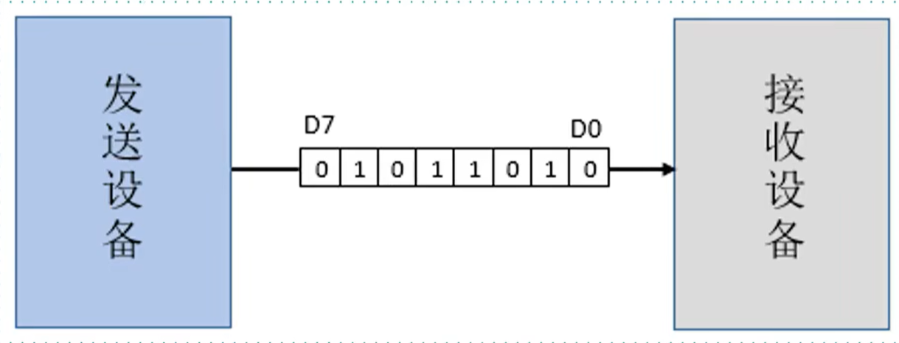
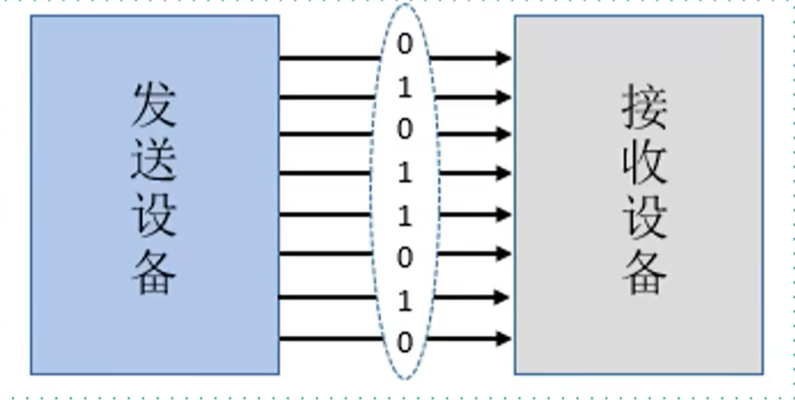
在简单介绍一些常用的通信协议及我们将重点学习的UART之前，先介绍单工与双工的概念。
数据通常是在两个站（点对点）之间进行传输，按照数据流的方向可分为三种传输模式：单工、半双工、全双工。
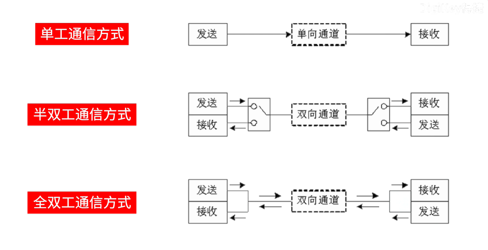
 **单工通信**：只支持信号在一个方向上传输（正向或反向），从一开始发射端和接收端就已经确立。为保证正确传送数据信号，接收端要对接收的数据进行校验，若校验出错，则通过监控信道发送请求重发的信号。生活中常见的例子有：电视机，显示器，打印机。
 **半双工通信**：一个信号载体上允许信号在两个方向上传输，但某一时刻只允许信号在一个信道上单向传输。通常应用于传输量小，通信速度要求不高的场合。生活中常见的例子有：对讲机。
**全双工通信**：允许数据同时在两个方向上传输，即有两个信道，因此允许同时进行双向传输，能提高通信速度和效率，适用于需要快速传输数据的场合。具体实现使用了两根独立的数据线保证两方向互不干扰。生活中常见的例子有：打电话，微信电话。

### 通信协议
为了规范和统一传输信息的方式，使得不同的设备能够直接进行通讯，一系列规则（包括通信线路、数据格式、传输速率等）被制定出来，这些规则就是通信协议。
首先是**波特率**（单位为bps），波特率表示表示一秒内传输多少段电平信号（码元）。两个利用 UART 通信的设备虽然可以时钟异步，但传输必须建立在相同的波特率上。接收设备按照已知的波特率，对发送设备发送的信号进行间隔采样，即可拿到该次的数据。 
接下来是**数据帧**，UART 以数据帧为单位收发数据。平常状态下一直为高电平，称做空闲。一个数据帧需要由一个周期的低电平开头，称做起始位。
接下来是 8/9 个时间周期的**数据位**，为每次传送的有效数据，数据位的最后一位可以为**奇偶校验位**，数据位之后紧跟停止位，表示该次传输结束，可以选择 1 或 2 位。
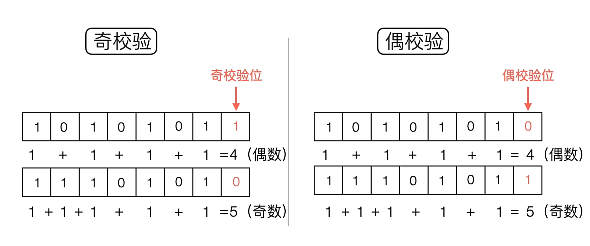
**奇偶校验位**：
1、传输介质可能受灰尘、油脂、静电等干扰，数据位在传输过程中可能发生翻转（0变1或1变0）。

2、实现原理：在原始数据位后额外添加一个校验位，使得整个数据（包括校验位）中“1”的个数符合奇校验：使“1”的总数为奇数（偶校验则为偶）。的规则：

3、检错过程：接收方收到数据后，重新计算包括校验位在内的“1”的个数，并与约定的奇偶性比对。若一致，则认为传输无误；若不一致，则判定数据出错。

4、局限性：只能检测出奇数个位的错误（如1位、3位翻转）。如果发生了偶数个位的错误（如2位同时翻转），则“1”的个数的奇偶性不会改变，校验就无法发现错误，也无法定位具体是哪一位出错。如果是偶数个错误就无法得知错误的位置。
 
而常见的串行通信协议有I2C,485,SPI，以及生活中常见的无线通信协议（如蓝牙协议，WIFI协议）。下面简单进行介绍。
**I2C（Inter-Integrated Circuit）**
集成电路间总线。采用双线（串行数据线，串行时钟线）。由于其总线制，可以连接多台设备，因此多用于在具体项目中连接各传感器及其他外设，并实现多设备控制。
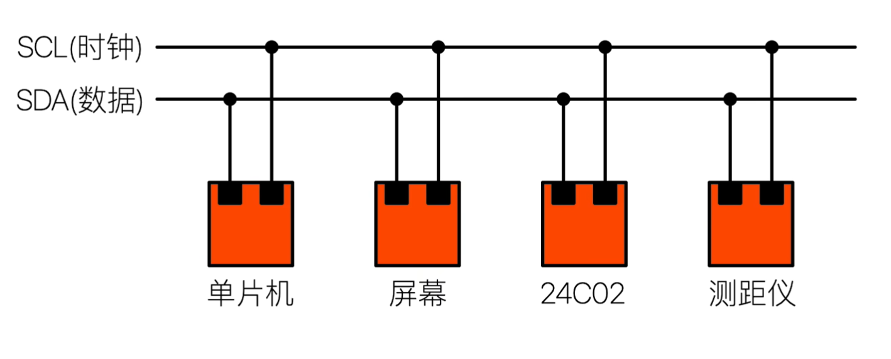
**RS-485（Recommended Standard）**
使用差分信号（两线电压差），可有效减少外界的电磁干扰，因此具有较好抗干扰能力。
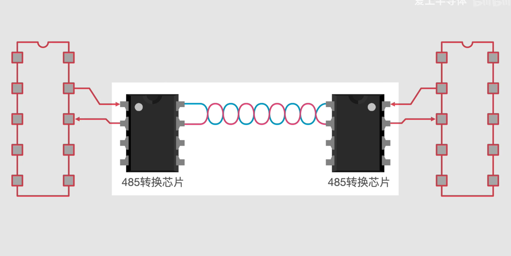

**SPI（Serial Peripheral Interface）**
串行外设接口，采用四线全双工制，常用于SD卡连接。
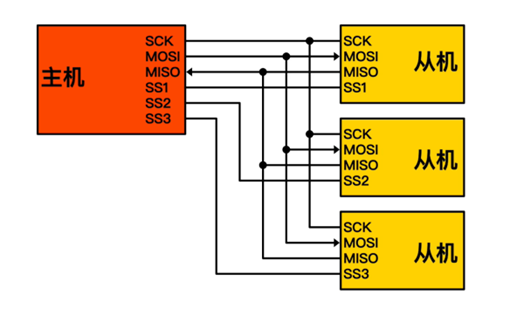

**蓝牙（Bluetooth）与Wi-Fi**
以无线电波为物理介质，但模块在底层与单片机连接时，仍然采用UART接口。二者主要差别在于带宽与功耗，具体的通信连接方式也有区别。
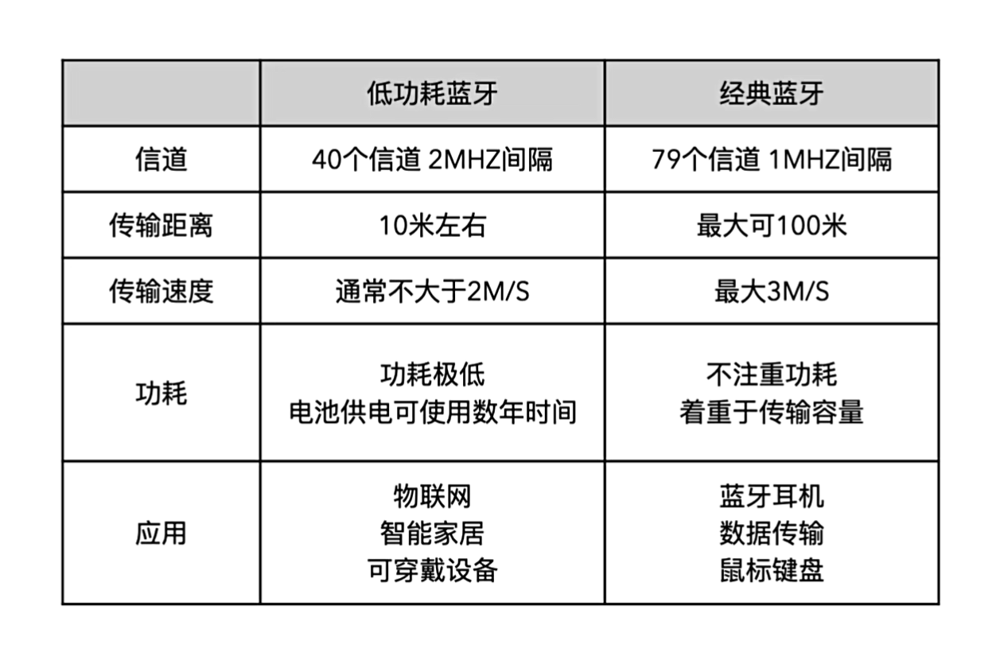
### UART的硬件设备
**UART是什么意思**
全称Universal Asynchronous Receiver Transmitter，即通用异步收发器，是一种通用的串行异步通信总线。而在UI（User Interface）界面上更常见的是USART，这是为什么呢？
1.软件上：USART 兼容 UART。关系很简单：USART 包含 UART,UART 只是 USART 的一种工作模式。 可以看到 UI 上有选项：USART1  /  USART2 /  USART3。但配置里选： Asynchronous（异步），那它就是你平时用的普通串口 UART。
2.忠于硬件真实名称 
硬件模块叫 USART。同一个硬件，既能异步，也能同步。工程师必须知道：这是多功能串口，不是只能异步。
所以UI 写 USART 。
**同步与异步**其具体的差别是： 在通信中有的时候需要同步两设备的时钟，此时称为同步，在硬件中会多出一条时钟线。不需要时钟同步时则为异步，此时采用波特率形式逻辑同步，使用UART通信时两设备以如下的交叉方式连接：一个设备的TX（发送端,transmitter）连接另一个设备的RX（接收端，receiver），且两设备共地。
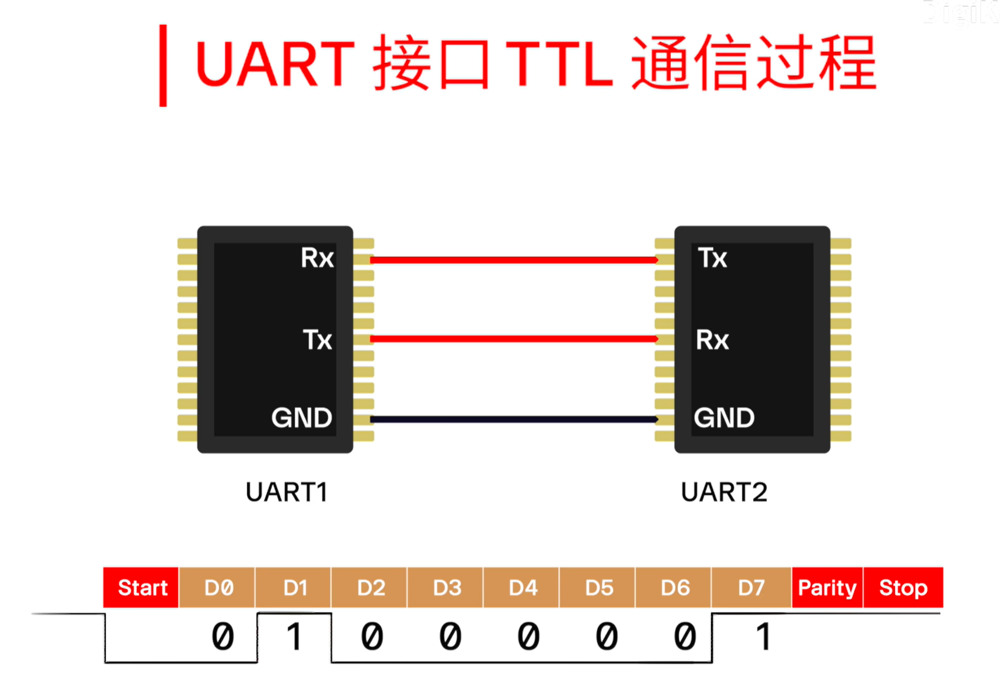


### 上下位机的概念

**上位机**指可以直接发送操作指令的计算机或单片机，一般能够提供操作交互界面并反馈数据。**下位机**指的是与机器相连接的计算机或单片机，接受和反馈上位机的指令，并根据指令控制机器执行动作和读取数据。在具体实验中，通常有上位机发送控制命令，下位机执行动作；上位机发送状态获取命令，下位机调用传感器并将数字信息反馈给上位机；下位机主动发送状态信息等几种情况。上下位机通常都需要独立进行编程。
在实验1的三个环节中，均为PC端担任上位机角色，单片机作为下位机。
#### 信息流对比分析

| 维度 | 过程一 (Transmit) | 过程二 (Receive) | 过程三 (Trans+Recv) |
| :--- | :--- | :--- | :--- |
| **流向** | 下位机 $\rightarrow$ 上位机 | 上位机 $\rightarrow$ 下位机 | 上位机 $\leftrightarrow$ 下位机 |
| **驱动源** | 下位机程序自发驱动 | 上位机人工指令驱动 | 上位机请求，下位机响应 |

## 二、 控制大师：寄存器的魔法

### 寄存器探秘
本节介绍 UART 常用的寄存器 
首先是**状态寄存器 USART_SR**，如下图所示。该寄存器的各位（Bit）表示了当前 传输过程的状态，例如 TXE 表示发送数据寄存器为空，TC 表示发送完成，RXNE表示读取寄存器不为空，ORE 表示溢出错误，FE 表示帧错误等。
这里我们关注一下两个位，第 5、6 位 RXNE 和 TC。 
1. **RXNE（接收数据寄存器非空）**  
   当该位被置1时，表示USART已经接收到数据，可读取`USART_DR`（数据寄存器）。为了避免数据丢失，应尽快读取`USART_DR`，此操作会自动清除RXNE位。此外，也可以手动向该位写入0来清零。  

2. **TC（发送完成）**  
   当该位被置1时，表示`USART_DR`中的数据已完全发送完毕。如果启用了该位的中断（TC中断），则会触发中断信号。清除TC位的方法有两种：  
   - 方法1：先读取`USART_SR`，再写入`USART_DR`。  
   - 方法2：直接向TC位写入0。 
   

此处提到的清零操作与实际应用相关。需要清零的原因‌是在STM32串口通信中，TC（Transmission Complete）标志位在串口初始化后默认为1。当数据从发送数据寄存器（TDR）完全移到移位寄存器并发送出去后，TC标志位会被置为1。如果不清零TC标志位，新的数据发送请求可能会被误判为不需要发送，导致数据发送覆盖。‌
具体介绍其他各位及其相应状态篇幅过长，感兴趣的读者自行了解。
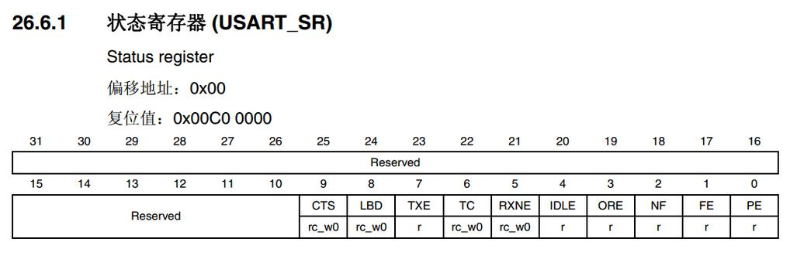 
*USART_SR 寄存器 27*  
STM32 的发送与接收是通过数据寄存器 USART_DR 来实现的，这是一个双寄存器，包含了 TDR 和 RDR。当向该寄存器写数据的时候，串口就会自动发送，当收到数据的时候，也是存在该寄存器内。该寄存器的各位描述如下图所示：
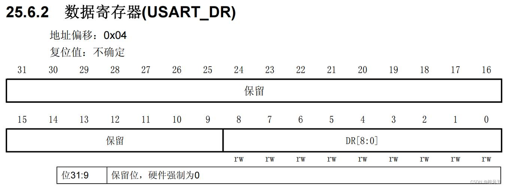 
*USART_DR 寄存器*  
可以看出，虽然`USART_DR`是一个32位的寄存器，但实际上只有低9位（`DR[8:0]`）用于存储数据，其余部分是保留位。  

- **`DR[8:0]`**：包含了串口传输的数据，既包括发送的数据，也包括接收的数据。  
- 由于`USART_DR`是一个双功能寄存器，它由两个部分组成：
  - **TDR**（发送数据寄存器）：用于存放待发送的数据。
  - **RDR**（接收数据寄存器）：用于存放接收到的数据。  

在发送操作时，向`USART_DR`写入数据时，数据会自动写入TDR；而在接收操作时，读取`USART_DR`时，数据会自动从RDR中提取。

此外，UART还包含波特率寄存器、预分频寄存器和三个控制寄存器，这些寄存器共同决定了串口的其他设置，这里不再一一详述，感兴趣的读者可以进一步了解。
### UART库函数
在 `stm32f4xx_hal_uart.h` 文件中，UART 相关的库函数声明如下图所示。实际上，只有最上面的 `Transmit` 和 `Receive` 函数直接与 UART 数据传输相关，其余函数则涉及中断、DMA 等功能。对于初学者来说，在掌握基本的 UART 功能后，可以再深入了解这些高级功能。在实验一中，我们仅使用了 `Transmit` 和 `Receive` 函数，而实验二则涉及了 `Transmit_DMA` 和 `Receive_DMA` 函数。
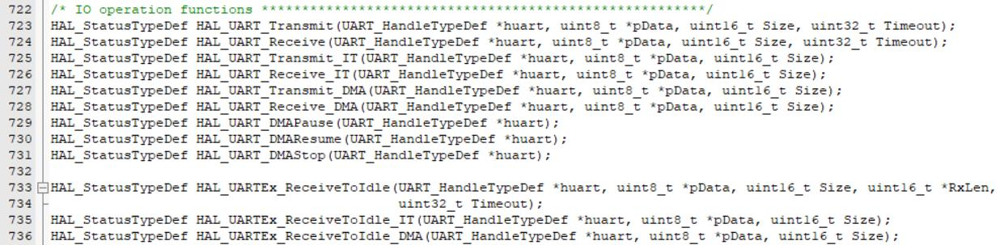
*部分UART库函数*  
 `HAL_UART_Transmit` 函数用于通过 UART 传输数据。它的声明如下：

```c
HAL_StatusTypeDef HAL_UART_Transmit(UART_HandleTypeDef *huart, uint8_t *pData, uint16_t Size, uint32_t Timeout);
```
它的参数依次为：

1. **UART 句柄**：指定使用的 UART 外设的句柄。例如，在生成的 `usart.c` 文件中，`USART3` 的句柄通常会自动声明为 `UART_HandleTypeDef huart3`。
2. **数据指针**：指向待发送数据的存储区域。这个参数通常是一个数组或字符指针。
3. **数据长度**：需要发送的数据的字节数。例如，如果要发送的字符串有 5 个字符，则填入 5。
4. **超时时间**：指定最大等待时间，单位为毫秒。通常，可以将其设置为最大值 `0xFFFF`，表示没有时间限制。

举个例子，如果你要使用 `USART3` 发送字符数组 `BUF[5] = "good!"` 中的内容，可以调用如下函数：
```c
HAL_UART_Transmit(&huart3, BUF, 5, 0xFFFF);
```
如果你想通过 `USART3` 发送一个变量，比如整数 num = 12345，可以调用如下函数：

```c
HAL_UART_Transmit(&huart3, (uint8_t*)&num, sizeof(num), 0xFFFF);
```
其中，注意HAL_UART_Transmit() 的函数中pData 是 uint8_t* 类型，所以(uint8_t*)&num 的作用是将 num 的地址转换为 uint8_t* 类型。

同理，`HAL_UART_Receive` 函数用于接收数据，参数与 `HAL_UART_Transmit` 几乎相同，只是第二个参数是接收数据的存储区域指针，用于存放接收到的数据。

简而言之，`HAL_UART_Transmit` 用于发送数据，而 `HAL_UART_Receive` 用于接收数据，二者的调用格式几乎一致，关键在于指定正确的数据存储区和相应的长度。

## 三、 实验1-Hello,STM32!第一个串口通信

### 实验要求  
1. 将开发板与上位机连接，当按下单片机上的按键时，通过 UART 向上位机发送字符串 "SEU"，并在上位机的串口调试助手中显示。
2. 程序同时会监听UART串口的数据接收，一旦接收到数据，就将数据通过UART回传。

### 实验思路  
按键操作与前一章相同，在每次循环中检测按键的高低电平，以判断是否被按下。不同的是，在检测到按键按下后，操作需要改为通过 UART 库函数向上位机发送相应的字符串。

### 初始化配置
**第一步**
设置 `PC13` 为输入模式 (`GPIO_Input`)。
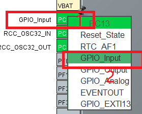  
**第二步**
右键点击`PC13`将`PC13`的User Label(用户标签)修改为B1（或者其他任何名称），方便后续编程。
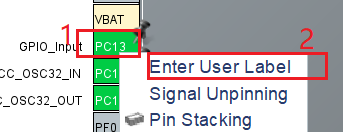

点击USART3后点击Mode,可以看到如下表的配置，其中Asynchronous为异步模式（开发通常采用的默认模式），Synchronous为USART特有的同步模式。其余带*号的课程不作涉及，有兴趣可自行了解。
点击Mode下一行的Hardware Flow Control（硬件流控制），默认Disable。可以注意到除RX、TX、GND外另有CTS、RTS。在早期串口通信中，为解决接收端缓冲区溢出导致的数据丢失问题，通过CTS与RTS来调节发送端与接收端的工作状态，以减少丢包率。随着单片机型号迭代，主频快速提升，处理数据的能力大大增强，高级通信协议能够检测丢包与超时，以及常用的节省引脚的UART+DMA模式已经能满足需求，现在开发中已很少使用。
|  选项   | 对应模式 |
|  ----  | ----  |
|==Asynchronous==  | 异步模式|
| Synchronous | 同步模式 |
|* Single Wire |单线半双工模式|
|* Multiprocessore Communication |多处理器通信|
|* IrDA|红外数据协会模式|
|* LIN|局域互联网总线|
|* Smart Card|智能卡模式|
|* Smart Card with Card Clock|带时钟智能卡模式|

USART3 保持如下默认配置即可，无需改动。
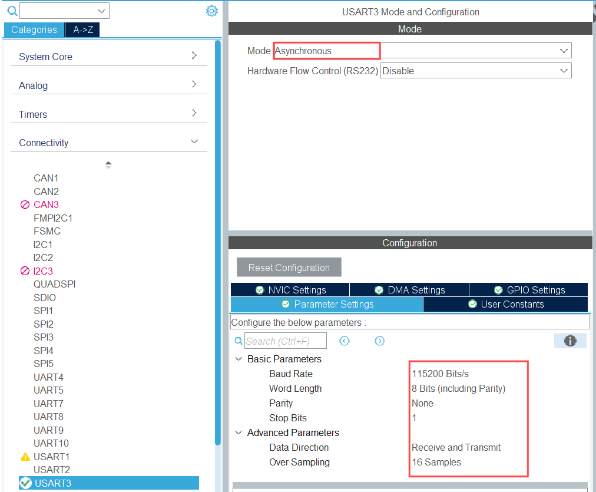
### 主程序代码  
在USER CODE BEGIN 0处，添加如下语句：
```c
/* 检测按键是否按下函数 */
	  uint8_t KeyPressed(void)
	  {
		  if (HAL_GPIO_ReadPin(B1_GPIO_Port, B1_Pin) == GPIO_PIN_SET)
		  {
			  HAL_Delay(20);  // 防抖
			  if (HAL_GPIO_ReadPin(B1_GPIO_Port, B1_Pin) == GPIO_PIN_SET)
			  {
				  while (HAL_GPIO_ReadPin(B1_GPIO_Port, B1_Pin) == GPIO_PIN_SET); // 等待松开
				  return 1;  // 按键按下
			  }
		  }
		  return 0;  // 按键未按下
	  }
```

在USER CODE BEGIN 2处，添加如下语句：
```c
uint8_t rxData;  // 接收数据缓冲区
```

在USER CODE BEGIN WHILE处，添加如下语句：
```c
// 1. 按键按下，发送 "SEU"
	  if (KeyPressed())
	  {
		  uint8_t msg[] = "SEU";
		  HAL_UART_Transmit(&huart3, msg, sizeof(msg) - 1, HAL_MAX_DELAY);
	  }

	  // 2. 轮询 UART 接收数据
	  if (HAL_UART_Receive(&huart3, &rxData, 1, 10) == HAL_OK)  // 10ms 超时
	  {
		  // 3. 回传收到的数据
		  HAL_UART_Transmit(&huart3, &rxData, 1, HAL_MAX_DELAY);
	  }
```

### 实验结果
将烧录好程序的开发板与电脑连接，打开串口调试助手实现收发。互联网上有大量可供使用的调试助手，这里我们使用仅用浏览器就可实现功能的波特律动串口调试助手https://serial.baud-dance.com（课后也可在CSDN或keysking配套网站上寻找相关内容部署至本地）。打开后界面如图所示。
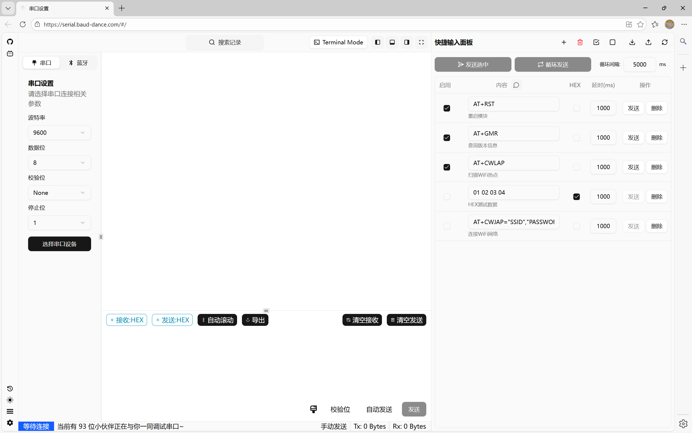
左侧栏可以选择波特率、数据位等配置。课后练习时串口连接设置选择USB Single Serial，点击重连后观察连接状态指示灯。
波特律动串口调试助手提供了较为便捷的快捷输入面板（右侧）。文本输入区域单击接受/发送：HEX可切换为ASCII模式，便于阅读可文本化内容，HEX模式便于查看源码。
通过串口调试助手，我们可以检验连接并进行简单的测试。另外，本串口助手还支持蓝牙功能调试，可在拓展实验中尝试使用。


在串口调试助手中，设置与STM32中初始化`USART3`的**参数一致**，特别注意选择正确的波特率和串口号（即ST-Link对应的串口号）。
此时，按下开发板上的按键，串口调试助手的屏幕上应显示"SEU"字符串，通过串口发送任意字符，单片机能接收到这个字符并立即回传,表示实验成功。


## 四、 实验2-DMA驾到：不定长数据不再是难题

### 什么是DMA
DMA（Direct Memory Access直接内存访问）用于在外设与存储器之间，或存储器与存储器之间实现高速数据传输。通过 DMA，可以在无需 CPU 参与的情况下快速移动数据，从而节省 CPU 资源，允许 CPU 执行其他任务。
### 实验要求
将开发板与上位机连接，使用上位机的串口调试助手向单片机发送数据。单片机在接收到数据后，将相同的数据返回给上位机，以确认接收成功。
### 初始化配置
**第一步**
在 CubeMX 界面中，进入 USART3 的配置页面，点击 **DMA Settings** 选项卡中的 **Add** 按钮，即可添加 DMA 通道。其中，**TX** 用于 USART3 的发送，**RX** 用于 USART3 的接收。分别添加 TX 和 RX 通道后，保持其余参数为默认值即可。
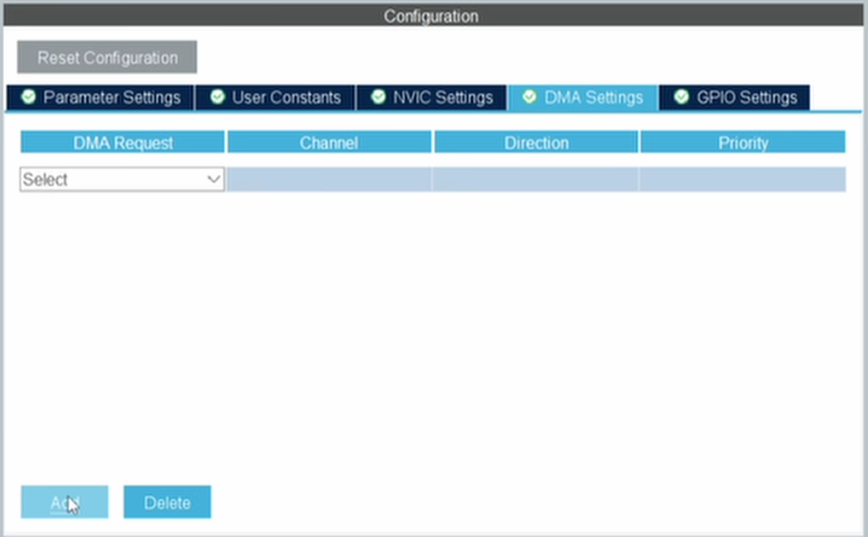
**第二步**
开启USART3 global interrupt，即后面会学习到的中断.
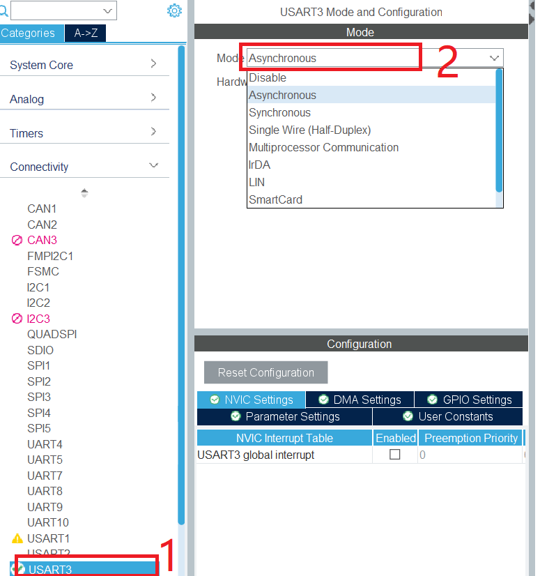
USART3的其余参数保持默认值即可。
### 主程序代码
由于要接受不定长数据，可以定义一个较大的数组
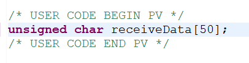  
在main函数中用DMA接收数据，我们采用`HAL_UARTEx_ReceiveToIdle_DMA`函数。
```c
HAL_UARTEx_ReceiveToIdle_DMA(UART_HandleTypeDef *huart, uint8_t *pData, uint16_t Size);
```

其中第一个参数和第二个参数与Transmit相同，第三个参数为接收数据的最大长度，一般填写接收数组的长度防止数组越界。

当该函数执行完成后，系统会触发中断函数：  

```c
HAL_UARTEx_RxEventCallback(UART_HandleTypeDef *huart, uint16_t Size)
```

在该回调函数中，我们可以处理接收完成后的数据。使用HAL_UART_Transmit_DMA可通过 DMA 发送接收到的数据，同时重新启动 UART 接收，以等待下一次数据传输。
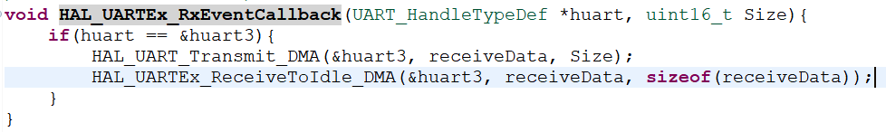
### 实验结果
将烧录好程序的开发板连接至电脑，并打开串口调试助手。确保其参数与 STM32 初始化 USART3 时的配置完全一致，并选择 ST-Link 对应的串口号。此时，在调试助手中输入数据，屏幕应显示单片机接收并回复的数据，实验成功。


## 五、 串口万花筒：发现UART的无限可能

### 实验中使用Micro-USB连接线进行UART通信的原因
尽管我们常常提到 UART 通信需要设备之间 **RX 接 TX，TX 接 RX** 并 **共地**，但在这个实验中之所以能够直接通过 Micro-USB 完成通信，是因为开发板的硬件设计中有额外的 **硬件模块** 来“桥接”通信信号。
在这个实验的开发板上，USART3的通信信号从核心 MCU（STM32F413）的 **PD8**（TX） 和 **PD9**（RX） 引出，但它们并没有直接连接到 Micro-USB 接口，而是被引入到另一个芯片（STM32F103）。
STM32F103 芯片是开发板上集成的ST-LINK/V2-1 模块的一部分。ST-LINK 的主要功能包括：  
- **下载和调试功能**：通过 USB 接口与 PC 连接，用于程序的烧录和调试。  
- **虚拟串口功能**（VCP，Virtual COM Port）：将 **USART3 的通信信号** 转换为 **USB 信号**，并通过 Micro-USB 接口传输到 PC（反向也适用）。  

在这里，ST-LINK/V2-1 模块相当于一个 **UART 转 USB 的硬件适配器**，负责桥接 UART 信号和 PC 上的 USB 通信。

由于 ST-LINK/V2-1 模块在硬件上已经完成了 **信号适配与线路连接** 的工作，因此在实验中直接使用 Micro-USB 连接线即可实现 UART 通信，而**无需手动将开发板的 RX 和 TX 引脚接线到 PC 的 USB 转串口模块上**。实验中UART通信的**底层逻辑并未改变，只是隐藏了手动接线的过程**。

### STM32与UART：从调试到项目应用的完美转换
串口不仅是调试的工具，它也是用户和嵌入式系统交互的一种方式。你可以通过串口接受来自用户的输入命令，控制开发板的行为。
应用实例：比如，开发一个串口控制的LED灯具，用户通过PC或上位机向开发板发送命令（例如“开启灯光”、“调节亮度”等），开发板根据接收到的命令控制灯的状态。也可以实现串口通信控制电机、传感器等其他外设。

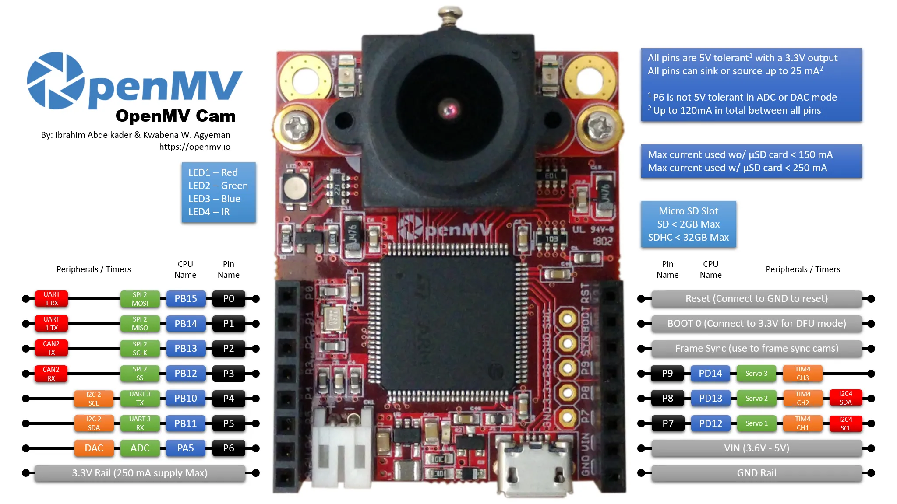  
*openmv模块*  
此图是电子类竞赛中常常用作图像识别的openmv摄像头模块，该模块自带一个STM32H7芯片，使用配套的开发环境可以使用python语言编写相关的图像处理的程序，由该模块本身运行，而该模块和系统的核心主单片机之间常常接线、供地使用UART通信。例如系统是一个小车，遇到红灯需要停车，则openmv中编程实现识别红灯并使用UART发送停车的信息，主单片机实现UART接收停车信息后控制车辆停止的功能。

### 串口与无线模块的联动：突破物理界限
通过蓝牙模块,UART接口实现了无线透传功能，简化了设备间的数据连接方式，同时保留了UART协议简单、可靠的特性。这种方法适合需要低功耗、短距离通信的应用场景。
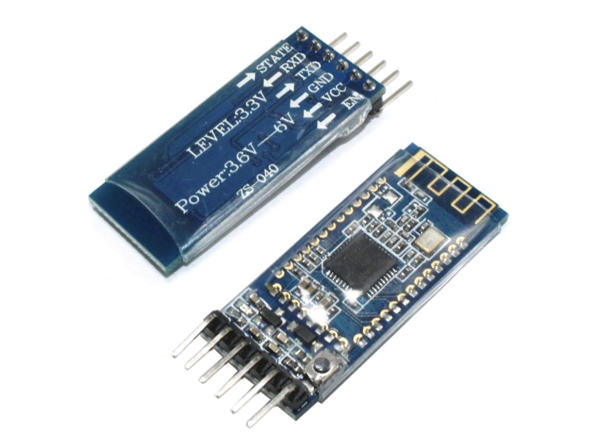  
*蓝牙模块*  
连接时注意线序正确：TX-RX RX-TX

**蓝牙模块的工作模式： 主从机模式**：一个蓝牙模块设为“主机”（Master），另一个设为“从机”（Slave）。
  - 在建立通信连接前，从机要向外广播自己的信息。
  - 主机扫描到附近正在广播的蓝牙设备后，就发起连接。


| 维度 | 上位机| 蓝牙模块| 单片机|
| :--- | :--- |  :--- | :--- |
| **角色** | 发送指令的主机 | 无线信号转串口信号 | 执行逻辑的从机 |
| **物理媒介** | 2.4GHz 射频信号 | 天线 + 内部逻辑芯片 | 铜线 (UART 电平) |
| **数据格式** | 蓝牙协议包 | 协议拆解与透传 | 原始字符 (ASCII) |
| **操作行为** | 点击 APP 发送 'a' | 接收无线电，从 TX 引脚输出 | `HAL_UART_Receive` 读到 'a' |


### 三种常见的数据传输方式
在UART通信中，轮询模式、中断模式和DMA模式是三种常见的数据传输方式，各有优缺点和适用场景。根据项目需求，合理选择合适的模式可以显著提升系统性能和资源利用率。

**工作原理**

 1. **轮询模式（Polling Mode）**  
主机通过不断检查UART的状态寄存器，判断是否有数据可读或数据发送完成。需要接收固定长度的数据。
1. **中断模式（Interrupt Mode）**  
通过启用 UART 的中断功能，当接收或发送完成时触发中断，CPU暂停当前任务去处理UART事件。
具体的中断操作将在下一节中介绍。
1. **DMA 模式（Direct Memory Access Mode）**
通过 DMA 控制器直接将数据从 UART 外设搬运到内存（或反向），无需 CPU 参与传输。


**特性对比**

| 特性           | 轮询模式 | 中断模式   | DMA 模式     |
| -------------- | -------- | ---------- | ------------ |
| **CPU占用**    | 高       | 中         | 低           |
| **实时性**     | 低       | 中         | 高           |
| **实现复杂度** | 简单     | 中         | 较复杂       |
| **适合数据量** | 小       | 中         | 大           |
| **应用场景**   | 简单任务 | 实时性任务 | 高吞吐量传输 |

**如何选择？**
1. **数据量小、任务简单**：选择轮询模式，易于实现。  
2. **实时性要求中等**：选择中断模式，减少 CPU 负担。  
3. **大数据传输且要求高效率**：选择 DMA 模式，解放 CPU。

## 四、思考题
 使用查询 （非中断） 方式, 实现串口接收处理功能, 满足以下要求： 
> 当上位机向开发板发送字符‘a’时，LD1点亮；
> 当发送字符‘b’时，LD2点亮；
> 当发送‘c’时LD1、LD2同时熄灭；
> 发送其他字符时两灯状态不变。
> 
**提示**
该实验中所使用的轮询模式，大致逻辑如下：使用while循环，CPU主动读取串口控制器的寄存器，设置超时时间防止持续停在查询状态，在下一个时间周期继续调用该函数进行检查。在本实验中，功能相对简单，单片机只需执行判断上位机发送信息是否为a/b/c的功能，没有其他需执行的任务，故轮询模式可以以较简单的方式实现。更加复杂的情境中，则需要用到下一章节将学习的中断。


## REFERENCE
[1]https://blog.csdn.net/gitblog_01143/article/details/156165487 波特律动串口调试助手使用新手教程
[2]https://gitcode.com/gh_mirrors/se/SerialAssistant/?utm_source=gitcode_aigc_v1_t0&index=top&type=card&uuid_tt_dd=10_16991620350-1756028395127-823415&from_id=156165487&from_link=9b15fa81eceab1c65362e0cc626da739
github-波特律动串口调试助手部署

::: info 本章修改记录   
2025/2 完成编写 (张佳、杨子骞、孙苡朔)   
2025/3 网页适配 (顾雨杭) 
2026/2 内容修改(侯禹腾、何彦毅、倪嘉杭)
:::
