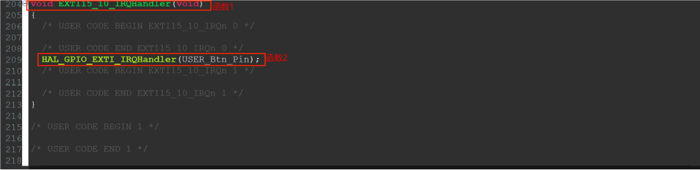
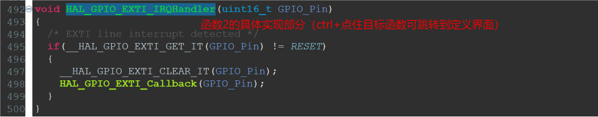
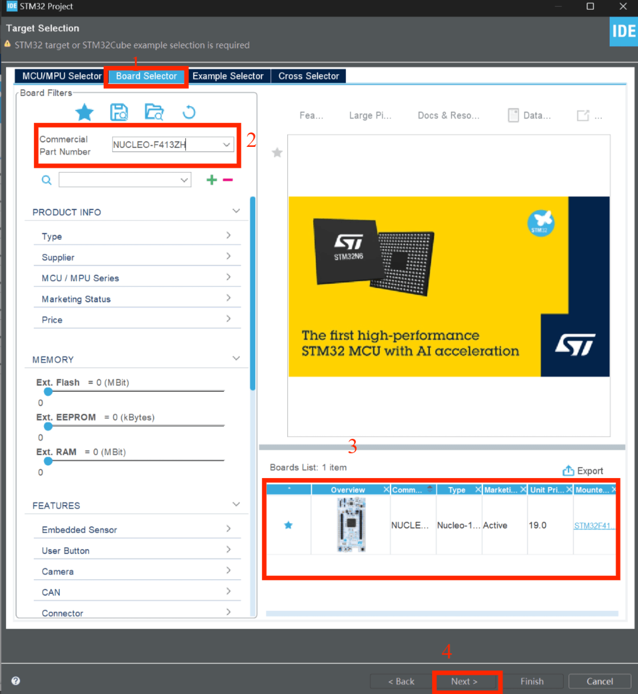
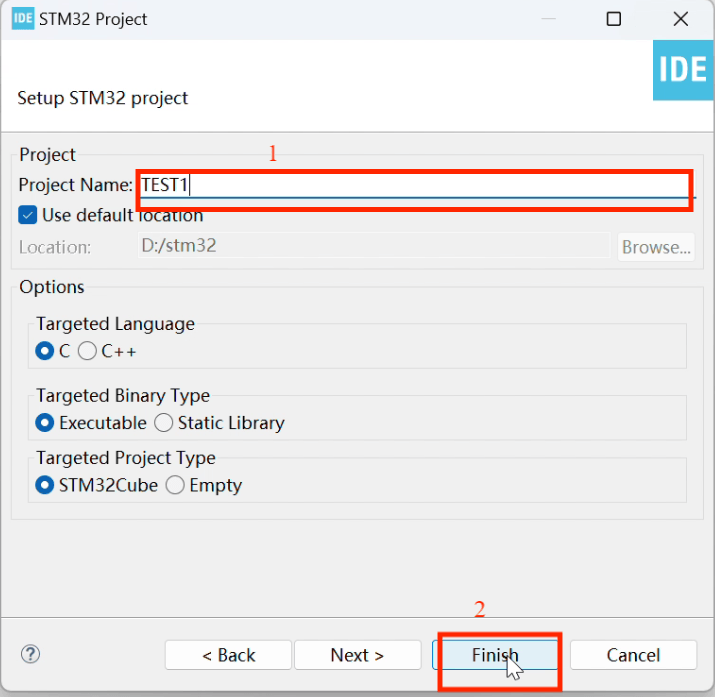
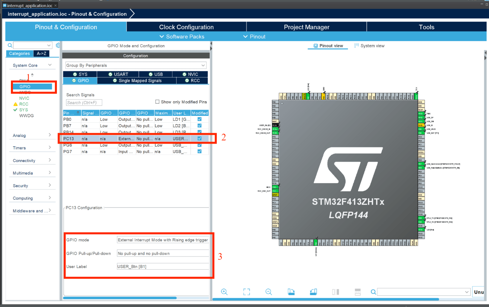
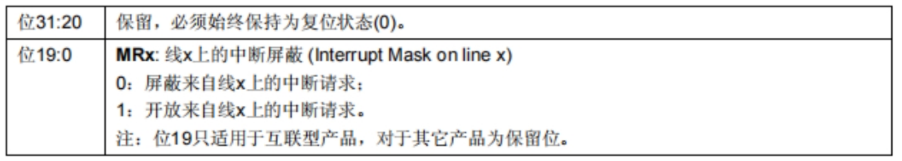

# 第五章 穿越时空的旅程-中断及其应用

## 一、中断简介

###  什么是中断？

想象一下你正在专心写作业，突然电话响了。这时候你会：

1. **记住当前写到的位置**（保存现场）
2. **接听电话**（处理中断）
3. **挂电话后回到刚才的位置继续写作业**（恢复现场）

单片机的中断就是这样一个"接电话"的机制！

**中断就是单片机被外部或内部事件打断，去处理紧急事情，处理完再回来继续原来的工作。**

###  中断是怎么工作的？

中断的完整流程就像一个智能的接电话系统：
```
正常工作 → 收到中断信号 → 保存当前状态 → 处理中断 → 恢复状态 → 继续工作
```

### 谁来管理中断？

当有很多电话同时打进来时，我们需要一个**智能电话总机**来管理：

- **哪个电话先接？**（优先级排序）
- **每个电话找谁接？**（中断分配）

这个智能总机就是**NVIC（嵌套向量中断控制器）**，负责管理所有中断的"接听顺序"和"人员分配"。

## 二、相关寄存器和库函数

### 外部中断控制器 EXTI

**EXTI工作流程**：
```
外部信号 → 引脚检测 → 边沿检测 → 中断请求 → NVIC处理 → 执行中断函数
```

EXTI就像是安装在单片机"门口"的门卫，专门负责检测外部信号的变化。STM32F4系列有20个EXTI线路（EXTI0-EXTI19），每个线路都可以独立配置。

**核心寄存器说明**：

| 寄存器     | 作用               | 比喻说明                 | 功能说明                                             |
| ---------- | ------------------ | ------------------------ | ---------------------------------------------------- |
| EXTI_IMR   | 中断屏蔽寄存器     | 门卫的工作时间表         | 控制哪些中断线可以向NVIC发送中断请求                 |
| EXTI_EMR   | 事件屏蔽寄存器     | 门卫的应急通道           | 控制哪些中断线可以产生事件（不进NVIC，直接触发脉冲） |
| EXTI_RTSR  | 上升沿触发选择     | 门卫对"上升动作"的敏感度 | 配置哪些线在信号上升沿时触发中断/事件                |
| EXTI_FTSR  | 下降沿触发选择     | 门卫对"下降动作"的敏感度 | 配置哪些线在信号下降沿时触发中断/事件                |
| EXTI_SWIER | 软件中断事件寄存器 | 门卫的"模拟演练"按钮     | 软件方式手动触发中断/事件，用于调试                  |
| EXTI_PR    | 挂起寄存器         | 门卫的"待处理事件记录本" | 当 EXTI收到中断请求时，挂起寄存器 EXTI_PR的相应端口会置为 1，该寄存器的内容与屏蔽寄存器的内容送至 NVIC，由 NVIC管理中断事件，后续产生响应。值得一提的是，每次中断处理完成后都需要清掉该位以等待下一次中断。           |


**中断与事件的区别**：

**中断路径**：信号 → 边沿检测 → 与门(IMR) → NVIC → CPU执行中断函数
**事件路径**：信号 → 边沿检测 → 与门(EMR) → 脉冲发生器 → 直接触发外设

> - 中断就像"报告问题"，等CPU来处理
> - 事件就像"紧急通知"，立即触发相关动作

**EXTI寄存器就像是门卫的各种记录本，决定了何时响应、如何响应外部信号。**

### 中断优先级管理

**中断优先级**就像医院的急诊室，病人按病情紧急程度分诊：
- **抢占优先级**：重症级别（数字越小越紧急）
- **响应优先级**：同重症级别的排队顺序

**NVIC优先级分组**：

ARM Cortex-M4的NVIC为每个中断分配4位优先级字段（0-15），这4位可以灵活分组：

| 分组方式 | 抢占优先级位数 | 响应优先级位数 | 抢占优先级范围 | 响应优先级范围 |
| -------- | -------------- | -------------- | -------------- | -------------- |
| 分组0    | 0位            | 4位            | 0              | 0-15           |
| 分组1    | 1位            | 3位            | 0-1            | 0-7            |
| 分组2    | 2位            | 2位            | 0-3            | 0-3            |
| 分组3    | 3位            | 1位            | 0-7            | 0-1            |
| 分组4    | 4位            | 0位            | 0-15           | 0              |

**优先级计算**：
- 每个中断的优先级值 = (抢占优先级 << (4-抢占位数)) | 响应优先级
- 数值越小，优先级越高
- 系统使用分组方式时，所有中断必须使用相同的分组

**中断嵌套机制**：

> - 抢占优先级就像"重症等级"：心梗患者（高优先级）可以打断普通感冒（低优先级）的治疗
> - 响应优先级就像"排队顺序"：同样是感冒患者，按挂号顺序排队

**优先级配置示例**：
```c
// 配置优先级分组（在系统初始化时设置）
HAL_NVIC_SetPriorityGrouping(NVIC_PRIORITYGROUP_2);  // 2位抢占，2位响应

// 配置具体中断的优先级
HAL_NVIC_SetPriority(EXTI15_10_IRQn, 1, 1);  // 抢占优先级1，响应优先级1
```
在图形化配置工具中，NVIC（嵌套向量中断控制器）的设置变得异常简便，其中，“Enabled”选项用于使能中断，例如前文在GPIO配置中勾选的EXTI中断使能，与此处EXTI项的“Enabled”实际上是同一设置，图中已显示使能成功。
​ “Preemption Priority”表示抢占优先级，而“Sub Priority”则为响应优先级。默认情况下，所有中断的这两个优先级是相同的。若需调整优先级，只需在对应中断的优先级栏中修改数值即可。


**实际应用场景**：
```
场景1：两个中断同时发生
比较抢占优先级 → 再比较响应优先级 → 最后按默认顺序

场景2：中断执行时又来新中断
只比较抢占优先级 → 高优先级可以打断低优先级

场景3：相同抢占优先级，不同响应优先级
不能互相打断，按响应优先级排队执行
```


**中断优先级就像急诊分诊，重症优先，同重症按顺序。**

### 常用库函数

**GPIO控制函数**：
```c
// 设置引脚电平
HAL_GPIO_WritePin(GPIO_TypeDef* GPIOx, uint16_t GPIO_Pin, GPIO_PinState PinState);
// 参数说明：GPIOx-端口组(A/B/C等), GPIO_Pin-引脚号, PinState-电平状态

// 读取引脚电平  
GPIO_PinState HAL_GPIO_ReadPin(GPIO_TypeDef* GPIOx, uint16_t GPIO_Pin);
// 返回值：GPIO_PIN_RESET(低电平) 或 GPIO_PIN_SET(高电平)

// 翻转引脚电平
void HAL_GPIO_TogglePin(GPIO_TypeDef* GPIOx, uint16_t GPIO_Pin);
// 功能：将当前电平状态反转，高变低，低变高
```

**中断管理函数**：
```c
// 使能/禁用外部中断线
void HAL_NVIC_EnableIRQ(IRQn_Type IRQn);                    // 使能中断
void HAL_NVIC_DisableIRQ(IRQn_Type IRQn);                   // 禁用中断

// 设置中断优先级
void HAL_NVIC_SetPriority(IRQn_Type IRQn, uint32_t PreemptPriority, uint32_t SubPriority);
// 参数：中断号，抢占优先级，响应优先级

// 获取当前中断优先级
uint32_t HAL_NVIC_GetPriority(IRQn_Type IRQn);

// 设置中断优先级分组
void HAL_NVIC_SetPriorityGrouping(uint32_t PriorityGroup);
```

**中断回调函数机制**：

HAL库采用**弱函数(weak function)**机制，用户可以在自己的代码中重写这些函数：

HAL库采用**弱函数(weak function)**机制，用户可以在自己的代码中重写这些函数：

```c
// 外部中断回调函数（用户在main.c中重写）
void HAL_GPIO_EXTI_Callback(uint16_t GPIO_Pin)
{
    // 用户自定义处理逻辑
    if(GPIO_Pin == GPIO_PIN_13) {
        // PC13引脚中断处理
    }
}

// 串口接收完成回调函数
void HAL_UART_RxCpltCallback(UART_HandleTypeDef *huart)
{
    // 串口接收完成后的处理
}

// 其他常见回调函数
void HAL_TIM_PeriodElapsedCallback(TIM_HandleTypeDef *htim);      // 定时器中断
void HAL_ADC_ConvCpltCallback(ADC_HandleTypeDef* hadc);          // ADC转换完成
void HAL_SPI_TxCpltCallback(SPI_HandleTypeDef *hspi);           // SPI发送完成

```
- 链接时优先使用用户定义的同名函数
- 如果用户没有定义，则使用库的默认实现（通常为空函数）

### 中断触发机制
在开始实验之前，先理解整个中断是怎么被调用的：

```
硬件触发中断 → 启动自动生成的中断服务函数(EXTI15_10_IRQHandler) 
→ 调用HAL库处理函数(HAL_GPIO_EXTI_IRQHandler) 
→ HAL库自动调用你写的回调函数(HAL_GPIO_EXTI_Callback)
```


**具体流程如下：**

1.  **硬件触发与入口跳转**：当外部设备（如按键）产生中断信号，CPU会通过NVIC（中断控制器）的仲裁，自动跳转到预先定义好的**中断服务函数 (ISR)**，例如 `EXTI15_10_IRQHandler`。具体处理器如何能够精准地根据中断类型跳转至对应中断程序处的原理，感兴趣的读者可以自行查阅资料了解。这个函数由开发工具（如STM32CubeMX）在 `stm32f4xx_it.c` 文件中自动生成。

2.  **HAL库介入处理**：在自动生成的 `EXTI15_10_IRQHandler` 函数内部，会调用HAL库提供的通用处理函数 `HAL_GPIO_EXTI_IRQHandler`。这个库函数承担了两个核心任务：
    *   **判断与清除标志位**：调用库函数HAL_GPIO_EXTI_GET_IT库函数判断中断标志位（即挂起寄存器中的对应位）是否为 1，无误后首先执行清除标志位（将挂起寄存器中对应位置 0），表示该中断已处理，此后等待接受下一次的该中断。
    *   **调用回调函数**：在完成标志位清除后，它会接着调用一个名为 `HAL_GPIO_EXTI_Callback` 的函数。

3.  **执行用户逻辑（核心）**：`HAL_GPIO_EXTI_Callback` 函数是HAL库留给开发者的接口。在库的源码（`stm32f4xx_hal_gpio.c`）中，它被定义为一个**弱函数 (用`__weak`修饰符定义)**。这意味着：
    *   库中提供了一个空的默认实现，保证即使开发者不写任何代码，编译也能通过。
    *   开发者可以在自己的 `main.c` 或其他应用文件中**重新定义一个同名函数**。链接器会优先使用开发者定义的“强”函数，从而覆盖库中的空实现。





**这种分层设计的优势：**

这种看似冗余的“套娃”式结构，实际上是现代嵌入式库函数设计的精髓，为开发者提供了极大的便利：

*   **逻辑标准化与安全性**：将清除中断标志位等必须执行的底层操作封装在HAL库中，避免了开发者因遗忘这些操作而导致程序死锁或行为异常，保护了系统的稳定性。
*   **关注点分离**：开发者无需关心复杂的中断向量、寄存器配置和标志位管理，也无需修改自动生成的系统文件。只需专注于在 `HAL_GPIO_EXTI_Callback` 函数中实现具体业务逻辑即可。
*   **代码解耦与可维护性**：通过`__weak`回调机制，彻底分离了底层驱动代码和上层应用代码。这使得代码结构清晰，易于维护、移植和复用。

总而言之，HAL库通过这种设计，巧妙地搭建了一座从底层硬件到上层应用的桥梁，极大地简化了中断开发流程，让开发者可以更高效地实现功能。


## 三、实验一：按键控制LED

**实验目的**：学习外部中断的基本应用，用按键控制LED灯的开关。

**实验要求**：按一次按键LED亮，再按一次LED灭，实现开关控制效果。

**实验思路**：
1. 配置按键引脚为外部中断模式
2. 在中断回调函数中翻转LED状态
3. 烧录测试效果

###  初始化设置

**创建工程**：首先打开 STM32CubeIDE 工具，新建工程,按照下图步骤选择我们的板子NUCLEO-F413ZH，然后点击下一步。



对我们的工程起一个名字，这里我就以"TEST1"命名，然后点击finish



此时若界面蹦出来询问我们是否需要给外设初始模式，我们选择yes

**配置GPIO**：我们在图形化界面中打开GPIO，找到PC13，将其输入模式改为上升沿触发的外部中断模式（即External Interrupt Mode with Rising edge trigger detection）。此时根据GPIO原理图，按键在未按下时为低电平，按下时为高电平



**使能中断**：接着打开NVIC，在其中选择EXTI line[15:10]interrupts将其勾选为Enabled状态，即可使能外部中断，完成初始化。如需配置其他GPIO，流程与上述相似。



### 代码编写

在main.c文件的`/* USER CODE BEGIN 4 */`后添加：

```c
// 外部中断回调函数
void HAL_GPIO_EXTI_Callback(uint16_t GPIO_Pin)
{
    // 判断是不是PC13引脚产生的中断
    if(GPIO_Pin == GPIO_PIN_13)
    {
        // 翻转LED状态（亮变灭，灭变亮）
        HAL_GPIO_TogglePin(LD1_GPIO_Port, LD1_Pin);
    }
}
```

**代码解释**：
- `GPIO_PIN_13`：PC13引脚的宏定义，用于识别中断源
- `LD1_GPIO_Port, LD1_Pin`：LED引脚的宏定义，指向PB0引脚
- `HAL_GPIO_TogglePin`：翻转引脚电平的函数，内部操作BSRR寄存器

###  实验结果

烧录程序后：
- 初始状态LED不亮
- 按一次按键LED亮起
- 再按一次按键LED熄灭
- 如此循环，实现开关功能

### 常见问题解决

**问题1：按一次按键LED闪烁多次**
- **原因**：按键抖动
- **解决**：在回调函数中加入延时消抖

**问题2：按键没有反应**
- **原因**：中断未正确使能或引脚配置错误
- **解决**：检查NVIC配置和GPIO模式设置

## 四、实验二：串口中断控制

**实验目的**：学习串口中断的应用，通过上位机发送指令控制LED。

**实验要求**：发送字符'A'控制LED开关，发送其他字符无反应。

**实验思路**：
1. 配置串口为中断接收模式
2. 在串口中断回调函数中判断接收到的字符
3. 根据字符内容控制LED状态

### 初始化设置

**配置串口**：在 "Pinout & Configuration" 视图中，点击 "Connectivity" -> "USART3"。
将 "Mode" 设置为 "Asynchronous"。
在 "NVIC Settings" 选项卡中，勾选 "USART3 global interrupt" 使能串口中断。


**配置LED**：在 "Pinout & Configuration" 视图中，点击 "System Core" -> "GPIO"。
选择 LD1对应的 GPIO 引脚（本实验选择 PB0），将其设置为 "Output Push Pull"。


### 代码编写

**变量定义**：在`/* USER CODE BEGIN PV */`之间添加：
```c
uint8_t rx_data[1];  // 存储接收到的数据
```

**中断回调函数**：在`/* USER CODE BEGIN 0 */`之间添加：
```c
void HAL_UART_RxCpltCallback(UART_HandleTypeDef *huart)
{
    // 将接收到的数据发送回去（回显）
    HAL_UART_Transmit_IT(&huart3, (uint8_t *)rx_data, 1);
    
    // 判断接收到的字符
    if(rx_data[0] == 'A')
    {
        // 如果是字符'A'，翻转LED状态
        HAL_GPIO_TogglePin(LD1_GPIO_Port, LD1_Pin);
    }
    
    // 重新开启串口接收中断，等待下一次接收
HAL_UART_Receive_IT(&huart3, (uint8_t *)rx_data, 1);
}
```

**开启中断**：在`/* USER CODE BEGIN 2 */`之间添加：
```c
// 开启串口接收中断
HAL_UART_Receive_IT(&huart3, (uint8_t *)rx_data, 1);
```

### 实验结果

1. 使用串口调试助手连接开发板（波特率115200）
2. 发送字符'A'：LED状态翻转
3. 发送其他字符：LED状态不变
4. 每次发送都有回显

### 调试技巧

**技巧1：串口打印调试信息**
```c
// 在回调函数中添加调试信息
if(rx_data[0] == 'A')
{
    printf("收到字符A，翻转LED\n");
    HAL_GPIO_TogglePin(LD1_GPIO_Port, LD1_Pin);
}
```

**技巧2：LED状态指示**
- 在程序中用LED的闪烁状态表示程序运行状态
- 比如正常时LED慢闪，出错时LED快闪

#### 中断调试进阶技巧

**1. 中断频率统计**
```c
// 在中断回调函数中统计触发次数
volatile uint32_t exti_count = 0;
volatile uint32_t uart_count = 0;

void HAL_GPIO_EXTI_Callback(uint16_t GPIO_Pin)
{
    if(GPIO_Pin == GPIO_PIN_13) {
        exti_count++;  // 记录外部中断次数
        HAL_GPIO_TogglePin(LD1_GPIO_Port, LD1_Pin);
    }
}

void HAL_UART_RxCpltCallback(UART_HandleTypeDef *huart)
{
    uart_count++;    // 记录串口中断次数
    // ... 其他处理
}
```

**2. 中断响应时间测量**
```c
// 使用DWT周期计数器测量中断延迟
#include "core_cm4.h"

volatile uint32_t interrupt_latency = 0;

void HAL_GPIO_EXTI_Callback(uint16_t GPIO_Pin)
{
    uint32_t start = DWT->CYCCNT;  // 获取当前周期计数
    // ... 中断处理逻辑
    uint32_t end = DWT->CYCCNT;
    interrupt_latency = end - start;  // 计算处理时间（周期数）
}
```

**3. 中断栈溢出检测**
```c
// 在启动文件中定义栈大小，运行时检查
__IO uint32_t stack_low_water_mark = 0xDEADBEEF;

// 在中断中检查栈使用情况
void check_stack_usage(void)
{
    if(stack_low_water_mark != 0xDEADBEEF) {
        printf("警告：可能发生栈溢出！\n");
    }
}
```

**技巧3：使用串口助手监控**
- 在中断回调函数中打印调试信息，实时监控中断触发情况
- 使用LED状态指示程序运行是否正常

## 五、其他应用

实际中外部中断广泛地运用在**键盘、遥控等外部设备和单片机的交互**中（其他类型中断的应用往往与该外设相关，此处不再赘述）。如图（a）所示为一种常用的 4X4 薄膜*键盘*，在实际的系统中，需要用户输入数据或者设置模式等操作往往需要键盘，该键盘的 8 根信号线分别对应 4行和 4 列，其原理图读者可以自行上网查询。开发者可以将行线设置为 EXTI 模式，列线设置为高电平输出，当某键按下时产生该行线上升沿，触发中断，执行相关操作。图 （b）为一种*红外遥控器*，用户可以借助其实现远程控制系统的功能，开发者可以设置红外接收器的一个引脚EXTI 模式，当红外接收器接收到遥控器发出的信号时，该引脚电平发生变化，触发中断，在中断程序中解析红外编码，再实现相应操作。图 （c）为一种*触摸屏*，通过一个引脚设置为EXTI 模式，当用户触摸时该引脚产生一个低电平，触发中断，在中断函数中获取触摸点坐标并且进行后续操作。感兴趣的读者可以上网更多资料了解。当然，以上模块可能不仅有外部中断种方式实现，事实上很多模块都有多种驱动方式，读者可以在开发中使用不同方式感受不同外设的优缺点。

### 键盘应用

4x4薄膜键盘是外部中断的典型应用场景：

- **行线**：设置为EXTI模式，检测按键按下
- **列线**：设置为输出，逐列扫描
- **工作原理**：当某键按下时，对应行线产生中断触发信号

### 红外遥控

红外接收器通过中断检测遥控信号：

- **接收器引脚**：设置为EXTI模式
- **信号处理**：中断触发后解析红外编码
- **应用场景**：电视遥控、空调遥控等

### 触摸屏

触摸屏使用中断检测用户触摸：

- **触摸检测**：触摸时产生低电平中断
- **坐标获取**：在中断中读取触摸坐标
- **响应处理**：根据坐标执行相应操作


**外部中断就像单片机的"触觉传感器"，能及时响应各种外部输入。**

## 六、思考题

### 基础题
1. 什么是中断？中断的完整流程是什么？
2. NVIC的作用是什么？抢占优先级和响应优先级有什么区别？
3. 外部中断和串口中断有什么相同点和不同点？

### 进阶题
1. 如果一个高优先级中断正在执行，此时来了一个低优先级中断，会怎么处理？
2. 如何实现按键的长按和短按识别？（提示：利用定时器和中断结合）
3. 多个按键共享一个中断线时，如何区分是哪个按键被按下？

### 挑战题
1. 请设计一个程序，实现：
   - 发送字符'a'时LD1点亮
   - 发送字符'b'时LD2点亮  
   - 发送字符'c'时两灯同时熄灭
   - 发送其他字符时状态不变

2. 如果要求改为：
   - 发送字符串"one"LD1亮
   - 发送字符串"two"LD2亮
   - 发送字符串"off"两灯熄灭
   代码该如何修改？
<!-- 
## 修改记录

```
本章修改记录
2026/2/12 全面重构，采用生活化比喻(陈际舟)
时间：重构中断简介，使用接电话机制比喻
时间：简化EXTI框图，增加代码注释
时间：优化实验步骤，增加调试技巧和常见问题解答
``` -->

## REFERENCE
[1] STM32F4xx HAL库用户手册
[2] ARM Cortex-M4 NVIC技术参考手册

::: info 本章修改记录   
2025/3 完成编写(薛晨烨、吕允成、张凤茹)
2025/3 网页适配 (顾雨杭)
2026/2 内容修改(肖博腾、高兮、陈际舟)
:::